<p align="center">
  
</p>

<p align="center">
  
</p>

<p align="center">
  <strong>Retrench</strong> is the keep-or-kill line for AI features.<br/>
  Watch unit economics drift. See what changed. Decide: <b>keep</b>, <b>fix</b>, or <b>kill</b>.
</p>

<p align="center">
  Find which agent-powered features make money — and which ones stopped.<br/>
  Join <a href="https://neatlogs.com">neatlogs</a> (runtime) · <a href="https://entire.io">entire.io</a> (change) · <a href="https://cfo.ai">cfo.ai</a> (money).
</p>

<p align="center">
  <a href="#table-of-contents">📚 Documentation</a>
  &nbsp;·&nbsp;
  <a href="#5-user-experience">💬 Product UI</a>
  &nbsp;·&nbsp;
  <a href="#9-aws-hackathon-setup">🐛 AWS setup</a>
</p>

<p align="center">
  
  
  
  
</p>

<p align="center">
  
  
  
  
  
</p>

---

## Table of contents

- [Problem](#1-problem)
- [Product idea](#2-product-idea)
- [How each integration is used](#3-how-each-integration-is-used)
- [Agents to build and use](#4-agents-to-build-and-use)
- [User experience](#5-user-experience)
- [Worked example](#6-worked-example-checkout-recovery)
- [System architecture](#7-system-architecture)
- [Implementation plan](#8-implementation-plan)
- [AWS hackathon setup](#9-aws-hackathon-setup)
- [API sketch](#10-api-sketch)
- [Success criteria](#11-success-criteria)
- [Out of scope (v1)](#12-out-of-scope-v1)
- [Quick start](#quick-start-local--aws)

---

## 1. Problem

Companies ship many agent-powered features (checkout recovery, support refunds, onboarding copilots). Today those teams use disconnected tools:

- Observability shows failures and token spend, not contribution margin.
- Coding agents change prompts and tools daily, with weak links to prod regressions.
- Finance models know runway and COGS, but not *which AI feature* burned the week.

The recurring unanswered question:

> **Which AI features make money this week, which ones stopped, what commit/session caused it, and should we fix, pause, or kill?**

---

## 2. Product idea

### One-liner

**Retrench** treats every AI feature as a live P&L and draws the keep-or-kill line when unit economics vary: runtime from neatlogs, change causation from Entire, money truth from cfo.ai.

### Unit of analysis: Feature

A **Feature** is a product surface backed by one or more production agents.

| Feature | Production agent(s) |
| --- | --- |
| Checkout Recovery | `checkout_agent` |
| Support Refunds | `support_triage` → `refund_agent` |
| Onboarding Copilot | `onboarding_copilot` |

Each Feature tracks:

- **Volume** — attempts / successes  
- **Cost** — tokens, tools, retries, escalations  
- **Failure tax** — refunds, credits, churn risk, lost GMV  
- **Contribution** — value created or protected per success  
- **Change lineage** — last Entire sessions/commits that moved the numbers  

### Core formulas (maintained in cfo.ai)

```text
Contribution_F     = Successes_F × Value_per_success_F
Agent_OpEx_F       = Σ (tokens + tools + infra attributed to F)
Failure_Tax_F      = Failures_F × Cost_per_failure_F
                   + Credits / chargebacks attributed to F
Net_Feature_Margin = Contribution_F − Agent_OpEx_F − Failure_Tax_F
```

- `Successes`, `Failures`, `Agent_OpEx` ← **neatlogs**  
- `Value_per_success`, `Cost_per_failure`, scenarios ← **cfo.ai**  
- Margin cliffs → causal `commit` / session ← **entire.io**

---

## 3. How each integration is used

### neatlogs — runtime truth

**Must do (not optional):**

- Ingest production agent traces for each Feature.
- Emit daily / hourly rollups: attempts, successes, cost per success, failure classes.
- Open incidents when behavior or economics regress.
- Provide Investigate / fix briefs (critical spans only) to coding agents via MCP/CLI.
- Verify “fix stays fixed” after a patch.

**Does not invent:** dollar contribution or margin.

### entire.io — change truth

**Must do:**

- Checkpoint coding-agent sessions to git commits for Retrench and agent repos.
- On a margin cliff, resolve “what changed?” to session + commit + files/prompts touched.
- Keep a Feature timeline of behavior-changing sessions (bad change + fix session).

**Does not invent:** prod metrics or financial impact.

### cfo.ai (Ari) — money truth

**Must do:**

- Hold Feature assumptions (`Value_per_success`, `Cost_per_failure`, AOV, margin %).
- Compute Net Feature Margin with deterministic engine + lineage.
- Expose scenarios: Restore retries / Pause feature / Raise autonomy caps.
- Surface portfolio view for founder/finance (keep / fix / kill).

**Does not invent:** run counts or git blame; those are inputs from neatlogs / Entire.

### Proper-use test

| Product | Fail if you only… |
| --- | --- |
| neatlogs | Show pretty logs with no Feature rollups or fix verification |
| entire.io | Mirror git without session↔commit on Feature changes |
| cfo.ai | Chart tokens without a real model/scenario |

---

## 4. Agents to build and use

### A. Production agents (instrumented, not rebuilt)

These already run in the customer’s product. Retrench observes them via neatlogs.

Examples for the hackathon demo:

| Agent | Role |
| --- | --- |
| `checkout_agent` | Completes failed checkouts without double-charge |
| `support_triage` | Routes support intents |
| `refund_agent` | Issues refunds under policy |
| `onboarding_copilot` | Answers activation questions |

Stack suggestions: LangGraph / CrewAI / OpenAI Agents SDK — anything neatlogs can wrap.

### B. Retrench control agents (the product)

| Agent | Responsibility | Tools / backends |
| --- | --- | --- |
| **Portfolio Agent** | Rank Features by Net Margin; flag regressions | neatlogs rollups, cfo.ai inspect |
| **Investigate Agent** | Build three-chapter brief: Runtime → Change → Money | neatlogs MCP/API, Entire checkpoints, cfo.ai |
| **Fix Brief Agent** | Shrink incident to coding-agent-ready patch brief | neatlogs Investigate |
| **Scenario Agent** | Ask Ari: fix vs pause vs kill; show $ delta | cfo.ai MCP (`inspect_*`, `edit_scenarios`) |
| **Watchdog Agent** | After resolve, confirm margin + failure class recovered | neatlogs detections + cfo.ai metrics |

### C. Coding agents (execution path)

Used to *implement* fixes, tracked by Entire:

- **Cursor** / **Claude Code** / **Codex**
- Flow: Fix Brief Agent → coding agent applies patch → Entire checkpoints session↔commit → Watchdog verifies in neatlogs + Ari

### D. Optional security detector (v1.1)

Reuse neatlogs detections (PII in output, anomalous tool sequences). Not required for the unit-economics MVP, but fits the same incident → Entire → Ari path.

---

## 5. User experience

### Personas

| Persona | Opens Retrench to… |
| --- | --- |
| PM / feature owner | Keep / fix / kill with money, not vibes |
| Engineer | Jump to the session that broke economics |
| Founder / finance | See AI features as a portfolio of P&Ls |
| Support lead | Know when quality issues are margin events |

### Screen 1 — Home: Feature Portfolio

One composition, not a dashboard soup.

- Headline: **Your AI features are running. Here’s what’s making money.**
- Primary number: Net AI Feature Margin (7d) from cfo.ai
- Primary list: Features ranked by status / $ impact
- Primary CTA: **Investigate** top regression

Example list:

```text
Feature                 Status      Net contrib (7d)   Cost/success   Driver
Checkout Recovery       🔴 Regress  $82k (−$34k)       $1.40          retries removed
Support Refunds         🟢 Healthy  $41k               $0.22          —
Onboarding Copilot      🟡 Watch    $9k                $0.95          retry loops
```

### Screen 2 — Feature detail (three chapters)

Every serious view tells one story:

1. **Runtime (neatlogs)** — success rate, cost/success, open incidents, evidence spans  
2. **Change (entire.io)** — commit, coding session, files/prompts touched  
3. **Money (cfo.ai)** — contribution, OpEx, failure tax, scenarios  

Actions:

- Hand fix brief to coding agent  
- Open / compare Ari scenarios  
- Pause feature autonomy (policy flag)  
- Mark resolved → Watchdog on  

### Screen 3 — Investigate / War room

Plain-English root cause + links out:

- neatlogs incident ISS-284  
- Entire checkpoint `a1b2c3`  
- Ari scenario “Restore retries”  

### Screen 4 — Money / scenarios

Finance-friendly:

- Assumptions with lineage (AOV, margin %, cost per failure)  
- Scenario compare: Keep broken / Fix / Pause  
- Approve budget or autonomy caps  

### Daily habit

- **Morning:** portfolio → clear top red Feature  
- **Slack:** `@retrench Why did Checkout Recovery margin drop?`  
- **After fix:** automatic “fix stays fixed” + margin back to baseline  

### What “good” feels like

- Eng: red alert → verified fix without pasting giant traces  
- PM: kill/keep decision in one screen  
- Finance: AI features as real line items in Ari  

---

## 6. Worked example: Checkout Recovery

### Assumptions in cfo.ai

| Assumption | Value |
| --- | --- |
| AOV | $85 |
| Gross margin on recovered order | 42% → ~$35.70 contribution / success |
| Target cost / success | &lt; $0.80 |
| Expected cost of failed recovery | ~$12 |

### Healthy week

| Metric (neatlogs) | Value |
| --- | --- |
| Attempts | 4,200 |
| Success rate | 85% |
| Cost / success | $0.61 |

Ari: Net Feature Margin ≈ **$117k** for the week. Entire: last change Aug 20 (added retries) — stable.

### Regression (v2.8)

Coding agent removes retries on `create_checkout`.

| Source | Signal |
| --- | --- |
| entire.io | Commit `a1b2c3`, session “remove checkout retries” |
| neatlogs | Success 85% → 62%; cost/success $0.61 → $1.40; ISS-284 (218 failing runs) |
| cfo.ai | ~$5k/day lost contribution vs expected |

### Resolution path

1. Investigate Agent emits three-chapter brief.  
2. Fix Brief Agent → Cursor/Claude restores bounded retries.  
3. Entire checkpoints fix session.  
4. Watchdog confirms success rate + cost/success + Ari margin recovery.  

---

## 7. System architecture

```text
┌─────────────────────┐     traces      ┌──────────────┐
│ Production agents   │ ───────────────►│  neatlogs    │
└─────────────────────┘                 └──────┬───────┘
                                               │ rollups / incidents
                                               ▼
┌─────────────────────┐   session↔commit  ┌──────────────┐
│ Coding agents       │ ─────────────────►│  entire.io   │
│ (Cursor/Claude/…)   │                   └──────┬───────┘
└─────────────────────┘                          │ causation
                                               ▼
                                        ┌──────────────┐
                                        │   Retrench   │
                                        │  (this app)  │
                                        └──────┬───────┘
                                               │ assumptions / scenarios
                                               ▼
                                        ┌──────────────┐
                                        │   cfo.ai     │
                                        │    (Ari)     │
                                        └──────────────┘
```

### Hackathon deploy shape (AWS)

```text
Internet → ALB → EC2 (API + web UI)
                 │
                 ├─ Lambda (scheduled rollup / watchdog)
                 └─ outbound HTTPS → neatlogs, Entire, cfo.ai MCP/APIs
```

Use the supplied **Hackathon_VPC** only. Do **not** create a VPC.

---

## 8. Implementation plan

### Phase 0 — Repo & instrumentation (day 0)

1. Demo app with 1–2 production agents (`checkout_agent`, optional `onboarding_copilot`).  
2. `neatlogs.init()` + wrap LLM/agent clients.  
3. `entire enable` on the demo repo; commit with a coding agent so checkpoints exist.  
4. cfo.ai workspace: Feature table blocks + variables for assumptions.

### Phase 1 — Core backend

1. **Feature registry** — id, name, agent names, Ari variable keys, neatlogs project filters.  
2. **Ingest job (Lambda)** — pull neatlogs rollups → store Feature daily metrics.  
3. **Causation join** — on regression, query Entire for commits/sessions in the window.  
4. **Margin sync** — push/read metrics via cfo.ai MCP; compute Net Feature Margin in Ari.  
5. **Investigate API** — returns Runtime + Change + Money chapters.

### Phase 2 — Product UI

1. Portfolio home  
2. Feature detail (three chapters)  
3. Investigate panel + “Hand to coding agent” deep link / MCP prompt  
4. Scenario panel (read Ari scenarios; optional write to non-Main scenario)

### Phase 3 — Agents inside Retrench

1. Portfolio Agent (rank + alert)  
2. Investigate Agent (brief)  
3. Fix Brief Agent  
4. Watchdog Agent (post-fix verification)

### Phase 4 — Demo script (hackathon)

1. Show healthy Checkout Recovery card.  
2. Apply bad change via coding agent (remove retries) → Entire checkpoint.  
3. Simulate / replay failing runs into neatlogs.  
4. Portfolio turns red; Investigate shows all three chapters.  
5. Fix via coding agent; Watchdog + Ari show recovery.  

### Suggested stack

| Layer | Choice |
| --- | --- |
| API | Python FastAPI or Node (Nest/Express) on EC2 |
| UI | Simple React/Vite or server-rendered pages |
| Jobs | AWS Lambda (EventBridge schedule) |
| Secrets | IAM role on EC2/Lambda + env for API keys (no long-lived keys in git) |
| Agent SDKs | OpenAI / Anthropic + neatlogs wrap; cfo.ai MCP; Entire CLI in repo |

---

## 9. AWS hackathon setup

Follow these constraints exactly.

### Hard rules

| Rule | Detail |
| --- | --- |
| Region | **us-east-1** only |
| Network | Use the supplied **Hackathon_VPC**. **Do not create a VPC.** |
| Allowed services | **EC2**, **Lambda**, **IAM roles**, and **load balancers** only |
| EC2 count | **One EC2 instance per team.** Terminate it before replacing it. |
| Instance families | **t2**, **t3**, or **t3a** |
| Instance sizes | **nano through large** |
| EBS | **50 GB maximum** |
| Budget | Stay within the team’s **$25 allowance** |
| Cleanup | **Stop / terminate resources when finished** |

### Recommended minimal topology

1. **IAM**
   - Instance profile role for EC2: CloudWatch logs (optional), invoke Lambda (if needed), read secrets from env injected at launch.
   - Lambda execution role: basic execution + permission to reach your API if you use internal callbacks.
   - Least privilege; no wildcard admin.

2. **EC2 (single instance)**
   - Type suggestion: `t3.small` or `t3.medium` (stay well under $25 with short runtime).
   - Root volume: ≤ **50 GB** gp2/gp3.
   - Place in **Hackathon_VPC** public or private subnet per organizer instructions.
   - Security group: inbound **80/443** from the ALB SG only; SSH **22** only if required and locked to your IP; outbound HTTPS for neatlogs / Entire / cfo.ai.

3. **Application Load Balancer**
   - In Hackathon_VPC.  
   - Listener HTTP/HTTPS → target group → your single EC2.  
   - Do not add extra LBs.

4. **Lambda**
   - Scheduled rollup / Watchdog (EventBridge → Lambda).  
   - Small memory (128–256 MB), short timeout.  
   - No VPC attachment unless organizers require it (avoids ENI cost/complexity). If it must reach private EC2, follow hackathon VPC guidance without creating a new VPC.

5. **Do not**
   - Create a new VPC, NAT gateway, RDS, ElastiCache, ECS cluster, or other services outside the allowlist.  
   - Leave instances running after the demo.  
   - Resize by running two EC2s — **terminate** the old one first.

### Cost hygiene ($25)

- Prefer **t3.nano / t3.micro / t3.small**.  
- Stop EC2 when not developing; terminate when done.  
- Delete unused ALBs (ALBs accrue hourly cost).  
- Keep Lambda invocations low (e.g. rollup every 15 minutes during demo, not every minute forever).  
- EBS ≤ 50 GB; delete unattached volumes.  
- Pull large models? Prefer API calls to OpenAI/Anthropic over GPU (GPU not in allowlist anyway).

### Bootstrap checklist

```text
[ ] Region set to us-east-1
[ ] Using Hackathon_VPC (no new VPC)
[ ] IAM roles created for EC2 (+ Lambda)
[ ] One EC2 launched (t2/t3/t3a, nano–large, EBS ≤ 50 GB)
[ ] ALB → EC2 target group healthy
[ ] Lambda schedule for rollups / watchdog
[ ] Env: NEATLOGS_API_KEY, CFO_AI credentials/MCP, Entire configured in git repo
[ ] Demo agents instrumented; sample traces visible in neatlogs
[ ] After hackathon: stop/terminate EC2, delete ALB, remove unused roles if required
```

---

## 10. API sketch

```http
GET  /api/features                 # portfolio list + status
GET  /api/features/:id             # three-chapter detail
GET  /api/features/:id/investigate # runtime + change + money brief
POST /api/features/:id/scenarios   # ask Ari for fix/pause/kill compare
POST /api/features/:id/resolve     # start Watchdog verification
GET  /api/health                   # ALB health check
```

### Feature status machine

```text
healthy → watch → regress → investigating → fixing → verifying → healthy
                         ↘ paused
```

---

## 11. Success criteria

The hackathon demo succeeds when judges can see:

1. **Portfolio** ranks Features with Net Margin (cfo.ai).  
2. A **regression** appears after a coding-agent change (Entire session↔commit).  
3. **Investigate** shows Runtime (neatlogs) + Change (Entire) + Money (Ari) without hand-waving.  
4. A **fix brief** is handed to a coding agent and a fix commit is checkpointed.  
5. **Watchdog** shows failure class cleared and margin recovering.  
6. AWS deploy respects **us-east-1**, **Hackathon_VPC**, **EC2/Lambda/IAM/ALB only**, **one EC2**, instance/EBS/budget rules.

---

## 12. Out of scope (v1)

- Full company-wide Agent Control Plane / SIEM replacement  
- Creating or managing customer VPCs  
- Multi-EC2 / Kubernetes / GPU training  
- Replacing neatlogs, Entire, or Ari — Retrench **orchestrates** them  
- Automatic production deploys without human approval  

---

## Quick start (local → AWS)

```bash
# 1) Instrument demo agents with neatlogs (Python example)
pip install -U neatlogs
# neatlogs.init(); neatlogs.wrap(OpenAI)

# 2) Enable Entire in this repo, then commit via your coding agent
# entire enable --agent cursor   # or claude-code, etc.

# 3) Connect cfo.ai MCP / workspace and create Feature assumptions

# 4) Run Retrench API + UI locally, then deploy to the single EC2 behind ALB
```

Exact package layout and deploy scripts can live under `apps/` and `infra/` as the implementation proceeds.

---

## Positioning

| Prevalent today | Retrench |
| --- | --- |
| Trace viewers | Feature P&Ls + keep/kill line |
| Coding agents without prod/$ join | Session → commit → margin cliff |
| Finance models without agent runtime | Deterministic $ on real Feature volume |

**Tagline:** *Retrench AI features when unit economics break. Runtime measures the machine. Entire explains the change. cfo.ai prices the outcome.*

---

## License / hackathon note

Built for hackathon use under organizer AWS rules. Stay in **us-east-1**, use **Hackathon_VPC** only, **one EC2 per team**, allowlisted services only, and **stop resources when finished** to remain within the **$25** team allowance.
